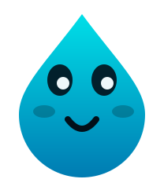
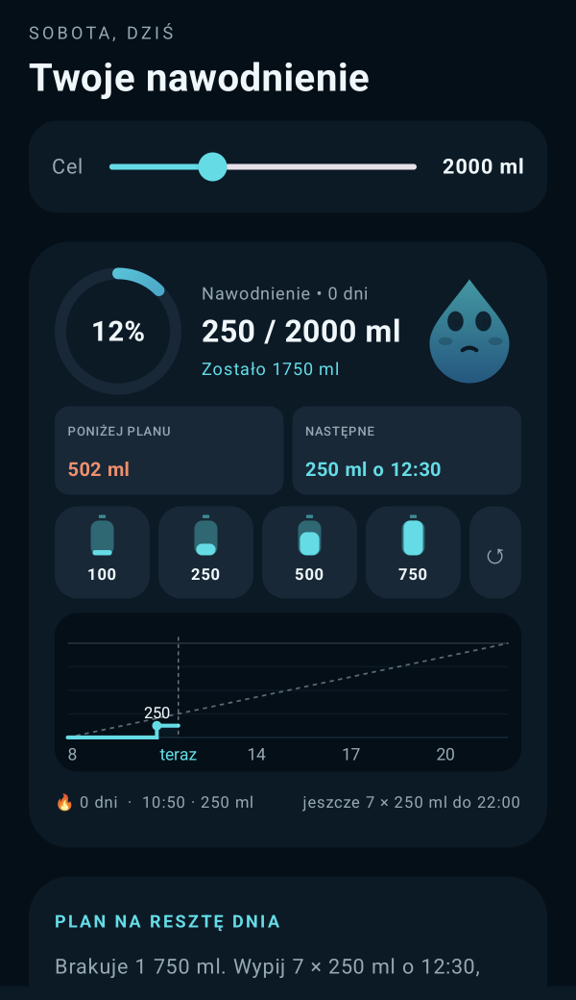
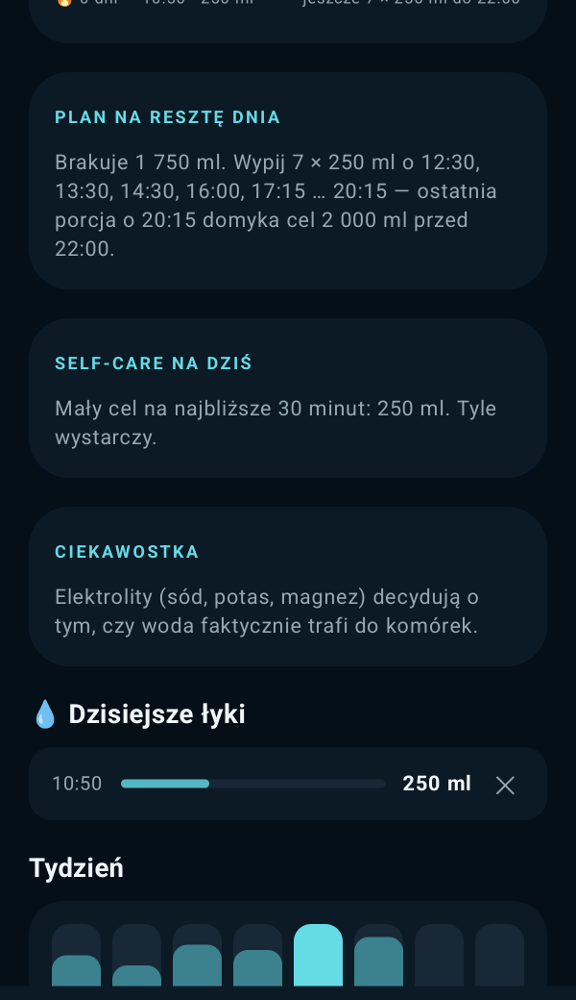
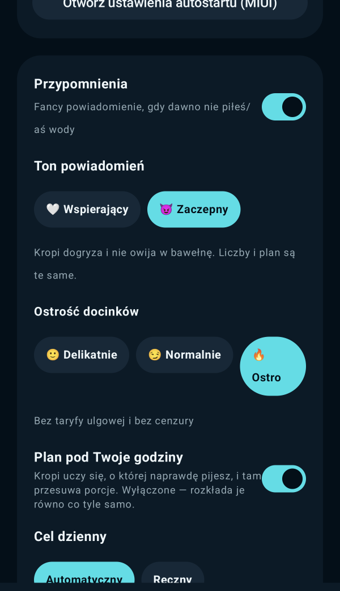
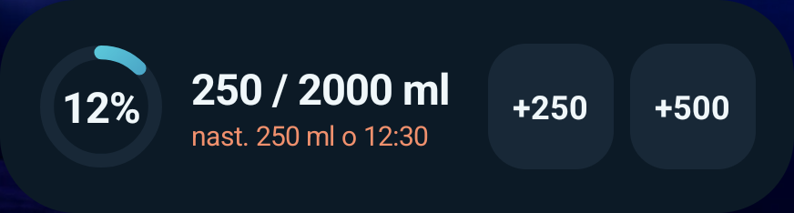
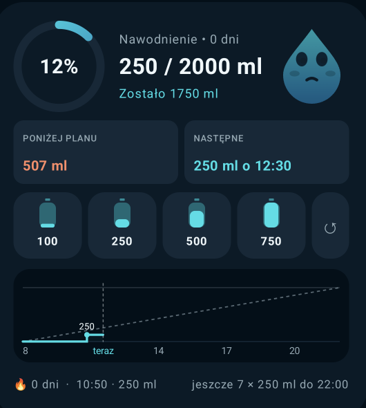

<div align="center">



# Kropi

**Woda z planem.**
Nie „pamiętaj o piciu". Konkret: wypij 250 ml o 15:10, i jeszcze 4× do 22:00 — wtedy cel będzie zrobiony.

**Polski** · [English](README.en.md)

<br />

[](https://github.com/pi0trdotsys/Hydration-Buddy/releases/latest)
&nbsp;

&nbsp;


<br />


&nbsp;&nbsp;

&nbsp;&nbsp;


</div>

<br />

## ◉ Plan zamiast przypomnień

Każda apka do wody umie napisać „napij się". Kropi liczy, **ile i o której**,
żeby dzień się domknął:

> **💧 Serio, tak trudno?** · 10% • cel 2 500 ml
> Wypij 250 ml o 15:40 — i jeszcze 8× do 22:00, a cel 2 500 ml będzie zrobiony.

Plan bierze Twój cel, okno picia i rozmiar szklanki, rozkłada brakujące
mililitry na równe porcje i podaje godziny. Gdy do końca dnia zostało mało
czasu, sam zwiększa porcje, zamiast obiecywać cel nie do zrobienia. Po
rozwinięciu powiadomienia widzisz cały rozkład, bilans względem planu na tę
porę i czas od ostatniego łyka.

Przycisk w powiadomieniu dolewa **dokładnie tyle, ile przewiduje najbliższa
porcja** — jedno dotknięcie i wracasz do swoich spraw.

## ◉ Widget, który naprawdę coś mówi

<div align="center">

</div>

Nie sam procent i nie anonimowe słupki. Duży kafelek pokazuje **schodkową
linię nawodnienia**: każdy skok to jeden łyk, podpisany objętością, na osi z
godzinami i znacznikiem „teraz". Obok biegnie przerywana **linia planu** — od
razu widać, czy jesteś nad nią, czy pod.

Do tego dwie pigułki stanu: `PONIŻEJ PLANU / 507 ml` (na pomarańczowo, gdy
odstajesz) i `NASTĘPNE / 250 ml o 12:30` z paskiem pokazującym, ile jeszcze możesz zwlekać. Na dole seria, ostatni zapisany łyk i
ile porcji zostało do końca dnia.

Cztery przyciski dolewania są na kafelku, więc **woda loguje się bez
otwierania aplikacji**. Pomyłkę cofasz strzałką obok. Pasek pod przyciskami pozwala **wybrać napój** (herbata, kawa, sok…) na najbliższe dolanie, a „**＋ wpis**" otwiera pełny edytor — także na łyk z przeszłości. Widget ma trzy układy:
pasek 4×1, kafelek 2×1 i duży 2×2 — każdy pokazuje tyle, ile się mieści.

Widget **dopasujesz do siebie**: przytrzymaj go i wybierz „Konfiguruj", żeby każdy z czterech przycisków zapisywał to, co chcesz (np. „kawa 200" jednym dotknięciem), oraz wybrać styl — własna paleta Kropi (jasna lub ciemna wg systemu) albo **Material You** z kolorów tapety (jest też wariant „Kropi ciemny", zawsze ciemny). Napój ma też „typową porcję": kawa zapamiętuje, ile zwykle pijesz. Dotknięcie wykresu otwiera listę dzisiejszych wpisów do poprawy, a po cofnięciu pojawia się „**Przywróć**" na kilka sekund. Gdy jesteś za planem, widget mówi wprost „Wypij teraz 250 ml", a o północy sam się zeruje. Są też dwa mniejsze widgety: **1×1 „dolej szklankę"** i **tygodniowy** z siedmioma słupkami i serią.

<div align="center">

</div>

## ◉ Kropi dogryza. Albo nie — Ty decydujesz

Maskotka ma dwa charaktery. **Wspierający** mówi jak przyjaciel po treningu.
**Zaczepny** nie owija w bawełnę:

> Cztery godziny bez wody. Twoje nerki wypełniły właśnie wniosek o urlop
> bezpłatny. Nawet zupka chińska dostaje więcej wody niż ty. Wstawaj i pij.
> Nie będę powtarzał.

Ton zaczepny ma trzy poziomy: 🙂 **delikatnie** (przytyk bez ostrych słów),
😏 **normalnie** i 🔥 **ostro** — ten ostatni bez cenzury, więc włączasz go
świadomie. Docinek dobiera się do tego, jak daleko jesteś od celu i jak długo
nie piłeś. Liczby i plan zostają te same, zmienia się tylko ton — także
maskotki w aplikacji.

Wieczorem, po zamknięciu okna picia, przychodzi **podsumowanie dnia**: bilans,
liczba łyków, seria i komentarz w wybranym tonie.

## ◉ Cisza, gdy trzeba

Przypomnienie nie przerywa spotkania: Kropi zagląda do kalendarza w telefonie
(tylko lokalnie, za Twoją zgodą) i czeka, aż się skończy. To samo robi, gdy masz
włączone „Nie przeszkadzać". Przypomnienie nie przepada — odezwie się po
wszystkim.

## ◉ Uczy się Twoich godzin

Kropi zapamiętuje, o której **naprawdę** pijesz, i tam przesuwa porcje —
zamiast rozkładać je równo co tyle samo. Ten sam cel, dwie różne osoby:

```text
ranny ptaszek   08:00  08:30  09:00  12:00  13:00  17:30
wieczorny       09:20  16:30  18:30  19:00  19:30  20:15
```

Pierwsza porcja nigdy nie wypada później, niż wynikałoby z równego rozkładu —
żeby „piję dopiero wieczorem" nie utrwaliło się na stałe. Nie podoba Ci się?
Jeden przełącznik w Ustawieniach i wracasz do równego rytmu.

## ◉ Woda bez otwierania aplikacji

- **Widget** — cztery przyciski na ekranie głównym, pojemności ustawiasz sam.
- **Kafelek w Szybkich ustawieniach** — jedno dotknięcie z rozwijanego paska,
  bilans dnia w podtytule.
- **Skróty spod ikony** — przytrzymaj ikonę i wybierz „Szklanka" albo „500 ml".
- **Powiadomienie** — przycisk dolewa zaplanowaną porcję, drugi odkłada
  przypomnienie o 20 minut.

## ◉ Cel policzony pod Ciebie

Cel dotyczy **napojów**, nie całej wody z jedzeniem: opiera się na zaleceniach
EFSA i NASEM (ok. 28 ml na kg z napojów), plus dodatek za ruch i upał. Jest
**realny do wykonania** — nie przekracza ok. 300 ml na godzinę aktywnego okna, a
w Ustawieniach widać, z czego się składa. Plan nie każe wypić więcej niż 500 ml
naraz (nerki wydalają ok. 0,8–1 l na godzinę), a karta **Regularność** pokazuje,
w ilu dwugodzinnych oknach faktycznie piłeś, jaka była najdłuższa przerwa i
ostrzega, gdy wlewasz w siebie za dużo naraz.

Podajesz wagę, temperaturę otoczenia i poziom aktywności — Kropi liczy cel
(ok. 33 ml na kilogram, plus bonus za upał i wysiłek). Wolisz własną liczbę?
Tryb ręczny i suwak. Do tego **aktywne godziny picia**, np. 8–22: w tym oknie
działają przypomnienia i liczy się tempo, poza nim Kropi daje spokój.

Chcesz, żeby cel liczył się sam? Połącz Kropi z **Health Connect**: waga i średnia
liczba kroków z tygodnia ustawiają cel, a to, co pijesz, trafia z powrotem do
Health Connect jako nawodnienie (alkohol pomijamy).

## ◉ Historia, która nie kłamie

Każdy zamknięty dzień ląduje w historii: ile wypite, jaki był cel, czy się
udało. Tydzień, **kalendarz miesiąca** (każdy dzień zabarwiony wg realizacji
celu, strzałkami cofasz się do starszych miesięcy), **ostatnie 30 dni**,
najlepszy dzień i **seria** — liczone z prawdziwych zapisów, nie z
przykładowych danych. Dotknij dnia w kalendarzu, żeby zobaczyć jego łyki,
poprawić je albo **dopisać zapomniany**. Karta **Trendy** porównuje tydzień z
poprzednim, pokazuje, o której zwykle pijesz pierwszą szklankę, w których
godzinach pijesz najwięcej i które dni tygodnia wychodzą Ci najlepiej. Całość
(dni albo pojedyncze wpisy z napojem i notatką) wyeksportujesz do **CSV** jednym
dotknięciem, bez żadnych uprawnień do pamięci.

## ◉ Nie tylko woda

Dotknij wpisu na osi czasu albo **„＋ Dodaj wpis"**, żeby dopisać łyk wstecz
(dziś lub wczoraj, o dowolnej godzinie), zmienić ilość albo dodać notatkę.
Każdy wpis ma **rodzaj napoju**: herbata, kawa, sok czy mleko liczą się do celu
częściowo (kawa np. 80%), napój gazowany 70%, alkohol wcale. Wolisz liczyć
wszystko 1:1? Wyłącz „Nawodnienie netto" w Ustawieniach. Historia pokazuje,
**co pijesz** w ostatnich 30 dniach.

## ◉ Kopie zapasowe i aktualizacje

Jak w Szpili: **kopia codziennie** (ostatnie 14) i kopia na żądanie ląduje w
`Pobrane/Kropi/Kopie`, a Ustawienia pokazują listę z przywracaniem. Przed
odinstalowaniem zrób kopię, a po ponownej instalacji wybierz ją przez
**Przywróć z pliku…** (nowa instalacja nie widzi plików poprzedniej — tak działa
Android). To samo okno wczyta też **CSV z eksportu historii**, jeśli używasz
starszej wersji bez kopii.

Aktualizacje przychodzą z tego repozytorium: Kropi sprawdza ostatnie wydanie,
**powiadamia, gdy jest nowsze**, pobiera APK i przed instalacją weryfikuje
sumę, pakiet, wersję i podpis. Zostaje ci jedno potwierdzenie w oknie systemu.

## ◉ Działa ze Szpilą

Masz [Szpilę](https://github.com/pi0trdotsys/Glow-Habit-Widget)? Woda logowana
w Kropi **trafia do niej sama** — koniec z wpisywaniem tego samego dwa razy.
Każde dolanie odświeża zadanie i widżety Szpili od razu, nawet gdy jest
zamknięta. Dane przechodzą lokalnie, przez dostawcę chronionego podpisem
aplikacji: czyta je wyłącznie Szpila, nic nie wychodzi z telefonu. Warunek: obie
aplikacje muszą być podpisane **tym samym kluczem** (patrz niżej).

<br />

---

<br />

## ◉ Po polsku i po angielsku

Interfejs, powiadomienia, widgety i teksty maskotki są w dwóch językach. Język
wybierzesz w ustawieniach Androida (**Aplikacje → Kropi → Język**) albo
zostawisz taki jak w telefonie. Aplikacja uwzględnia czytniki ekranu: przyciski
mają opisy dla TalkBacka, a elementy dotykowe mają co najmniej 48 dp.

## ▸ Instalacja

1. Pobierz plik **`kropi-hydration-….apk`** z
   [Releases](https://github.com/pi0trdotsys/Hydration-Buddy/releases/latest).
2. Otwórz go na telefonie i zezwól na instalację z tego źródła.
3. Uruchom Kropi, zgódź się na powiadomienia i wejdź w Ustawienia.

Wymagany Android 8.0 lub nowszy. Aktualizacje instalują się przez nadpisanie —
dane zostają.

## ▸ Pierwsze 2 minuty, które robią różnicę

Przy pierwszym uruchomieniu Kropi przeprowadzi Cię przez to samo w czterech
ekranach (cel, godziny, ton, powiadomienia, widget) — poniżej ściąga, gdzie
wszystko potem zmienisz.

|     | Gdzie                                                        | Po co                                                 |
| --- | ------------------------------------------------------------ | ----------------------------------------------------- |
| 🔔  | Zgoda na powiadomienia                                       | Przypomnienia z planem i podsumowanie dnia            |
| ⚖️  | Ustawienia → waga, temperatura, aktywność                    | Cel policzony pod Ciebie                              |
| 🕗  | Ustawienia → **Aktywne godziny picia**                       | Przypomnienia tylko wtedy, kiedy chcesz               |
| 😈  | Ustawienia → **Ton powiadomień**                             | Wspierający albo zaczepny, w trzech poziomach         |
| ➕  | Przytrzymaj ekran główny → **Widżety** → Kropi               | Dolewanie jednym dotknięciem                          |
| ⚡  | Szybkie ustawienia → edytuj kafelki → **Kropi**              | Woda z rozwijanego paska                              |
| 🔋  | Ustawienia systemu → Bateria → Kropi → **Bez ograniczeń**    | Przypomnienia punktualnie (Xiaomi, POCO, Samsung)     |

## ▸ Twoje dane są twoje

Wszystko zostaje na telefonie. **Bez konta, bez chmury, bez reklam, bez
śledzenia**. Internet służy wyłącznie do pytania GitHuba o nową wersję
(bez żadnych danych o tobie). Historię wyeksportujesz do CSV, kiedy chcesz, a
kopię zapasową zrobisz jednym dotknięciem. Jedyne, co wychodzi poza Kropi, to
woda przekazywana lokalnie do Szpili, jeśli ją masz.

<br />

<div align="center">

**Kropi** · woda z planem


</div>

<br />

<details>
<summary><b>Dla programistów</b></summary>

<br />

Repozytorium trzyma dwie rzeczy renderujące ten sam design:

- **`android/`** — właściwa aplikacja: Kotlin, Jetpack Compose, widget w
  Glance, stan w DataStore, przypomnienia na WorkManagerze. Sieć tylko do
  sprawdzania i pobierania aktualizacji z GitHuba.
- **`src/`** — makieta webowa (TanStack Start + React), z której wziął się
  design systemu: paleta, pierścień postępu, maskotka i układ kafelków.

Wybrane miejsca w kodzie:

| Plik | Za co odpowiada |
| --- | --- |
| [`data/HydrationPlan.kt`](android/app/src/main/kotlin/com/kropi/hydration/data/HydrationPlan.kt) | Rozkład porcji na godziny, w tym tryb adaptacyjny (kwantyle profilu godzinowego) |
| [`data/HydrationRepository.kt`](android/app/src/main/kotlin/com/kropi/hydration/data/HydrationRepository.kt) | Stan dnia, historia 400 dni, seria, profil godzinowy |
| [`data/SnarkContent.kt`](android/app/src/main/kotlin/com/kropi/hydration/data/SnarkContent.kt) | Druga osobowość Kropi: tytuły, docinki i zamknięcia w trzech poziomach ostrości |
| [`widget/HydrationWidget.kt`](android/app/src/main/kotlin/com/kropi/hydration/widget/HydrationWidget.kt) | Widget Glance w `SizeMode.Exact`; stan zbierany jako `Flow` **wewnątrz** `provideContent` |
| [`widget/WidgetGraphics.kt`](android/app/src/main/kotlin/com/kropi/hydration/widget/WidgetGraphics.kt) | `IntakeChart` — wykres dnia rysowany tym samym kodem na bitmapie (widget) i na `Canvas` (aplikacja) |
| [`backup/BackupStore.kt`](android/app/src/main/kotlin/com/kropi/hydration/backup/BackupStore.kt) | Kopie w `Download/Kropi/Kopie` przez MediaStore, kopia dzienna z rotacją 14; format w `BackupFormat.kt` |
| [`update/UpdateManager.kt`](android/app/src/main/kotlin/com/kropi/hydration/update/UpdateManager.kt) | Aktualizacje z wydań GitHuba: pobranie, SHA-256, kontrola pakietu/wersji/podpisu, instalator systemu |
| [`export/HydrationExportProvider.kt`](android/app/src/main/kotlin/com/kropi/hydration/export/HydrationExportProvider.kt) | Dostawca tylko do odczytu dla Szpili, chroniony uprawnieniem na poziomie podpisu |

```bash
cd android
./gradlew :app:assembleRelease
./gradlew :app:testReleaseUnitTest
adb install -r app/build/outputs/apk/release/app-release.apk
```

Wymagany JDK 21 i Android SDK 36. **Podpis:** `android/keystore.properties`
(poza gitem; `storeFile`, `storePassword`, `keyAlias`, `keyPassword`) — ten sam
klucz co w Szpili, bo uprawnienie `READ_HYDRATION` ma poziom `signature` i bez
zgodnego podpisu Szpila nie dostanie żadnych danych. Bez tego pliku build
wraca do klucza debug (instaluje się, ale z Szpilą nie rozmawia). Jeden klucz
dla wszystkich wydań sprawia też, że aktualizacje instalują się bez
odinstalowywania.

Makieta webowa: `bun install && bun run dev`.

</details>
